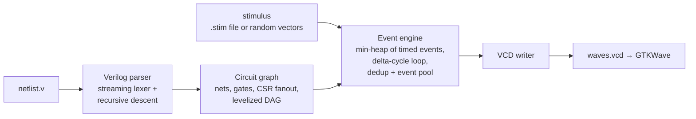

# logicsim: Event-Driven Gate-Level Logic Simulator

A C++17 gate-level logic simulator. It reads structural Verilog netlists, builds a circuit
graph, and simulates signal propagation with an event-driven engine that uses Verilog-style
delta cycles. The output is a VCD waveform that GTKWave and other standard viewers can open.

The codebase is meant to be read. It is small, has no dependencies beyond the C++17 standard
library, and is organised the way the textbook describes the pipeline: parser → graph → event
engine → waveform writer. Intended uses:

* learning how event-driven EDA simulators work
* digital design verification demos
* a starting point for experiments with simulation algorithms

```
$ ./build/logicsim examples/counter4.v --stim examples/counter4.stim --vcd counter4.vcd --outputs
final outputs at t=500:
  q[3] = 0
  q[2] = 1
  q[1] = 0
  q[0] = 1
...
```

## Contents

- [Architecture](#architecture)
- [Supported Verilog subset](#supported-verilog-subset)
- [Simulation semantics](#simulation-semantics)
- [Build](#build)
- [Run](#run)
- [Example waveform](#example-waveform)
- [Benchmarks and performance](#performance)
- [Design decisions](#design-decisions)

## Architecture



The same pipeline in ASCII:

```
 netlist.v ──► Verilog parser ──► Circuit graph ──────────► Event engine ──► VCD writer ──► out.vcd
               (lexer streams      (nets + gates, CSR        ▲  (min-heap of      (changes per
                tokens; one-pass    fanout, Kahn levelize,   │   events, delta      settled time
                recursive descent)  loop + driver checks)    │   cycles, DFFs)      step)
                                                             │
                                          stimulus (.stim file / random vectors)
```

| Module | Files | Responsibility |
|---|---|---|
| Logic values | `include/logicsim/logic.hpp` | 3-valued logic (0, 1, X) and gate evaluation |
| Verilog parser | `include/logicsim/verilog_parser.hpp`, `src/verilog_parser.cpp` | Streaming lexer and recursive-descent parser for the structural subset; builds the `Circuit` |
| Circuit graph | `include/logicsim/circuit.hpp`, `src/circuit.cpp` | Nets and gates, single-driver validation, CSR fanout lists, levelization (Kahn's algorithm), combinational-loop detection |
| Event engine | `include/logicsim/simulator.hpp`, `src/simulator.cpp` | Min-heap event queue, delta-cycle loop, flip-flop edge detection, event deduplication |
| Event pool | `include/logicsim/event_pool.hpp` | Chunked object pool with a free list for event objects |
| VCD writer | `include/logicsim/vcd_writer.hpp`, `src/vcd_writer.cpp` | IEEE 1364 Value Change Dump of every net |
| Stimulus | `include/logicsim/stimulus.hpp`, `src/stimulus.cpp` | `.stim` file reader and random vector generator |
| CLI | `src/main.cpp` | Command-line driver and statistics report |
| Benchmarks | `benchmarks/` | Netlist generator, 100- and 10K-gate netlists, benchmark script |
| Examples | `examples/` | Full adder (combinational) and 4-bit counter (sequential) with stimulus files |

### How the pieces fit

1. **Parser**
   * The lexer produces one token at a time. The parser keeps two tokens of lookahead, so
     memory stays flat even for multi-megabyte netlists.
   * Each gate instance becomes a `Gate`, and each signal (or vector bit) becomes a `Net`.
2. **Circuit graph**
   * `Circuit::finalize()` checks that every net has at most one driver and that primary
     inputs aren't driven by gates.
   * It builds the fanout of every net as one contiguous array plus offsets (CSR).
   * It levelizes the combinational gates with Kahn's algorithm. Gates left over are on a
     combinational cycle, which is reported as an error naming a gate on the loop.
   * The combinational logic is therefore a DAG. Flip-flops are the only way to close a loop.
3. **Event engine**: see [Simulation semantics](#simulation-semantics).
4. **VCD writer**
   * Observes the engine. At the end of every settled time step it writes the nets whose
     value changed.

## Supported Verilog subset

One module per file, structural only:

```verilog
`timescale 1ns/1ps                       // compiler directives are ignored
module top (clk, rst, a, b, y);          // non-ANSI port list ...
// module top (input clk, input [3:0] a, output y);   // ... or ANSI style
  input clk, rst;
  input [3:0] a, b;                      // vectors are expanded to one net per bit: a[3] .. a[0]
  output y;
  wire w1, w2;                           // undeclared nets in connections become implicit wires

  and  g1 (w1, a[0], b[0]);              // primitive: (output, input, input, ...)
  nand #2 g2 (w2, a[1], b[1], 1'b1);     // optional delay (#N or #(N)) and constants 1'b0/1'b1/1'bx
  or   (y, w1, w2), g4 (z, w1, a[3]);    // instance name optional; several instances per statement
  not  g5 (nb, b[2]);
  dff  f1 (q1, w1, clk);                 // flip-flop, positional: (Q, D, CLK [, RST])
  dff  #1 f2 (.Q(q2), .D(w2), .CLK(clk), .RST(rst));   // or named pins
endmodule
```

| Construct | Support |
|---|---|
| Gates | `and`, `or`, `nand`, `nor`, `xor`, `xnor` (1+ inputs), `not`, `buf` (1 input) |
| Flip-flops | `dff` / `DFF`: positive-edge D flip-flop with optional active-high asynchronous reset |
| DFF pins (named) | `.Q`, `.D`, `.CLK` (or `.CK`, `.C`), `.RST` (or `.R`, `.RESET`) |
| Declarations | `input`, `output`, `wire`, with optional `[msb:lsb]` range; `input wire` / `output wire` |
| Connections | scalar nets, bit-selects `a[3]`, constants `1'b0`, `1'b1`, `1'bx` |
| Delays | one integer delay per gate statement: `#N` or `#(N)`; default 0 |
| Identifiers | plain and escaped (`\bus[0] `) |
| Comments | `//` and `/* */` |

The parser rejects these with an error:

* `assign`, `always`, `initial`, `reg` (behavioural code)
* module instances and hierarchy
* `inout`
* instance arrays
* part-selects
* multi-output `buf`/`not`
* rise/fall delay pairs

Structural errors are reported with the net or gate involved:

* two drivers on one net
* a gate driving a primary input
* a combinational loop
* an out-of-range bit select

## Simulation semantics

### Values

Three-valued logic: 0, 1 and X (unknown).

* Every net starts at X.
* Controlling values dominate X: `and(0, x) = 0`, `or(1, x) = 1`. Otherwise X propagates.
* XOR and XNOR with any X input give X.

### Event queue

An event says "net *n* takes value *v* at time *t*".

* Future events live in a binary min-heap (`std::priority_queue`) ordered by `(time, sequence)`.
* The sequence number makes events at the same time FIFO, so runs are deterministic.

### Delta cycles

Simulation time advances only when the circuit is stable. For each time step:

```
pop every heap event with time == t                 ─┐
repeat (one iteration = one delta cycle):            │ one time step
  1. apply this delta's events; keep the nets whose value actually changed
  2. for each changed net, walk its fanout:
       combinational gate  -> queue it (dirty flag: evaluated at most once per delta)
       flip-flop           -> on a CLK rising edge sample D; on RST=1 force 0
  3. evaluate the queued gates; schedule their outputs:
       delay 0  -> event in the NEXT DELTA at the same time t
       delay d  -> event in the heap at time t + d
until a delta schedules nothing                      ─┘
report the settled changes to the VCD writer; advance to the next heap time
```

Zero-delay logic resolves entirely in delta cycles, so the number of deltas in a time step
follows the logic depth of the path that switched. Example from `examples/full_adder.v`: at
t=30 the stimulus moves `cin` from 0 to 1 while `a=0, b=1`.

| Delta | Applied | Evaluated | Scheduled for next delta |
|---|---|---|---|
| 1 | `cin=1` | `x2` (sum), `a2` (t2) | `sum=0`, `t2=1` |
| 2 | `sum=0`, `t2=1` | `o1` (cout) | `cout=1` |
| 3 | `cout=1` | (none) | (nothing): stable, advance time |

A gate with a delay (`and #3 ...`) schedules into the heap at `t+3` instead. Both kinds can be
mixed in one netlist; `examples/counter4.v` uses 1-unit gates and 2-unit flip-flops.

If a time step exceeds `--max-deltas` (default 10000), the engine stops with an error. That
would indicate an oscillation, which can't happen in a valid netlist because combinational
loops are rejected at load time.

### Flip-flops

`dff` is a positive-edge D flip-flop. It reacts only to changes on CLK and RST. A change on D
alone is not in the flip-flop's fanout.

* **Rising edge**: Verilog `posedge`, meaning 0→1, 0→x or x→1. On a clean 0→1 edge, D is
  sampled as it stands in the current delta. An edge involving x makes Q unknown.
* **New Q value**: scheduled for the next delta, or after the flip-flop's delay, like a
  non-blocking assignment. Flip-flops clocked by the same edge all sample their D before any Q
  changes, so shift registers and counters work without races.
* **Reset**: while RST is 1, Q is forced to 0 (asynchronous, active high). If RST is x when the
  clock rises, Q becomes x.
* **Caveats**:
  * If D changes in the same delta as the clock edge, the flip-flop sees the new D. This is the
    classic testbench race, so change data away from the active edge, as the random stimulus
    does.
  * Clock signals derived through zero-delay gates arrive a delta later than the raw clock.

### Time 0

Every combinational gate is evaluated once at time 0. Gates fed only by constants, or by inputs
already set at time 0, get a value without waiting for an input change.

### VCD output

Each time step's changes are written after the step settles. Glitches between delta cycles are
not dumped, which is also how Verilog simulators' `$dumpvars` output looks.

* **Variables**: every net is a 1-bit `wire` in the module's scope. Vector bits appear as
  `name [i]`, so viewers group them.
* **Initial values**: written in `$dumpvars` at `#0`.
* **Timescale**: `1ns`.

## Build

Needs CMake 3.16 or newer and a C++17 compiler: gcc 9+, clang 10+ or Apple clang. There are no
other dependencies.

```bash
cmake -S . -B build -DCMAKE_BUILD_TYPE=Release
cmake --build build -j
./build/logicsim --help
```

Release is the default build type. Built and run with Apple clang 21 (macOS, arm64) and with
gcc 14.4 (Linux, in the `gcc:14` Docker image), with `-Wall -Wextra -Wpedantic -Wshadow
-Wconversion` and no warnings.

## Run

```
logicsim <netlist.v> (--stim <file.stim> | --random <cycles>) [options]

  --stim FILE        stimulus file (time-stamped input assignments, clocks)
  --random N         N cycles of random input vectors
  --period P         cycle length in time units for --random (default 10)
  --clock NET        clock input for --random: low for P/2, then high
  --reset NET        reset input for --random: 1 during the first cycle, then 0
  --seed S           random seed (default 1)
  --vcd FILE         write a VCD waveform of every net
  --outputs          print the final value of every primary output
  --quiet            only print the statistics block
  --max-deltas N     delta cycles allowed per time step before giving up (default 10000)
  --no-dedup         schedule every gate output, even if it doesn't change the net
  --no-pool          allocate events with new/delete instead of the event pool
```

### Stimulus files

```
# comment
clock clk 20        # clk = 0 at t=0, rises at 10, 30, 50, ... (period 20)
end 500             # simulate until t=500 (default: time of the last assignment)
0   rst=1 en=0      # <time> <input>=<0|1|x> ...
13  rst=0 en=1
373 en=0
433 en=1
50  en=1            # bit-selects of vector inputs work too, e.g. 50 a[2]=1
```

### Random vectors

`--random N --period P --clock clk --reset rst` generates N cycles. In each cycle:

* At time `k·P`: the clock goes low and every other primary input gets a fresh random 0/1. The
  reset is 1 during cycle 0, then 0.
* At time `k·P + P/2`: the clock rises.

Data therefore changes half a period away from the active edge.

### Examples

```bash
# Combinational: full adder through all 8 input combinations (zero-delay, delta cycles only)
./build/logicsim examples/full_adder.v --stim examples/full_adder.stim --vcd full_adder.vcd --outputs

# Sequential: 4-bit counter with enable and asynchronous reset (gate and flip-flop delays)
./build/logicsim examples/counter4.v --stim examples/counter4.stim --vcd counter4.vcd --outputs
gtkwave counter4.vcd

# Benchmarks
./build/logicsim benchmarks/medium_10k.v --random 1000 --clock clk --reset rst --vcd medium.vcd
benchmarks/run_benchmarks.sh            # all sizes + optimisation ablations; prints the table below
```

Every run ends with a statistics block:

```
netlist              benchmarks/medium_10k.v (module bench_10000)
gates                10050 (1000 flip-flops), nets 10152, inputs 102, outputs 50, logic depth 20
parse_seconds        0.010
sim_seconds          0.127
sim_end_time         10000
input_changes        102002
time_steps           2000
delta_cycles         31083 (max 19 in one step)
events_scheduled     3020920
events_suppressed    4031238 (dedup on)
events_processed     3020920
net_changes          3020920
gate_evaluations     5948156
ff_updates           1002000
event_pool           65536 events allocated
events_per_second    23741586
peak_rss_mb          9.4
```

## Example waveform

`examples/counter4.v` with `examples/counter4.stim`, opened from `counter4.vcd`. Rendered as
text, one character per 5 time units, t = 0 to 250:

```
clk    __‾‾__‾‾__‾‾__‾‾__‾‾__‾‾__‾‾__‾‾__‾‾__‾‾__‾‾__‾‾__
rst    ‾‾‾_______________________________________________
en     ___‾‾‾‾‾‾‾‾‾‾‾‾‾‾‾‾‾‾‾‾‾‾‾‾‾‾‾‾‾‾‾‾‾‾‾‾‾‾‾‾‾‾‾‾‾‾‾
q [0]  x______‾‾‾‾____‾‾‾‾____‾‾‾‾____‾‾‾‾____‾‾‾‾____‾‾‾
q [1]  x__________‾‾‾‾‾‾‾‾________‾‾‾‾‾‾‾‾________‾‾‾‾‾‾‾
q [2]  x__________________‾‾‾‾‾‾‾‾‾‾‾‾‾‾‾‾_______________
q [3]  x__________________________________‾‾‾‾‾‾‾‾‾‾‾‾‾‾‾
t      0         50        100       150       200
```

How to read it:

* **Reset**: `q` starts at x. `rst=1` at t=0 clears it to 0 at t=2, after the flip-flops'
  2-unit delay. Without the reset the counter would stay at x forever, because its next state
  depends on its current state.
* **Clock**: the clock rises at t=10, 30, 50, and so on.
* **First counted edge**: at t=10 the reset is still active. Counting starts at t=30, and the
  counter changes 2 units after each rising edge: 1 at t=32, 2 at t=52, 3 at t=72.
* **Final value**: after 18 counted edges the counter has wrapped to 2 (18 mod 16). `en=0`
  holds it for the edges at 390–430, then it counts to 5 by t=500.

The VCD also records the internal nets, so in GTKWave the carry chain (`c1`..`c3`) and next
state (`d [3:0]`) can be seen settling 1–3 units after each Q change.

## Performance

**Benchmark netlists.** `benchmarks/gen_netlist.py` generates random synchronous logic, and the
output is deterministic for a given seed:

* levels of `and/or/nand/nor/xor/xnor/not/buf` gates with 1–4 inputs, mostly fed from the
  previous few levels
* 10% D flip-flops, with posedge clock and async reset, whose outputs feed back into the logic
* output buffers on the last level

All gates are zero-delay, so all propagation happens in delta cycles.

| Netlist | Gates | Flip-flops | Inputs | Logic depth | File |
|---|---|---|---|---|---|
| small | 104 | 10 | 10 | 6 | `benchmarks/small_100.v` (committed) |
| medium | 10,050 | 1,000 | 102 | 20 | `benchmarks/medium_10k.v` (committed) |
| large | 100,500 | 10,000 | 1,002 | 31 | `benchmarks/generated/large_100k.v` (generated by `run_benchmarks.sh`, 5 MB) |

**Workload.** 1,000 clock cycles of random input vectors, which is 2,000 time steps (each cycle
has a data step and a rising-edge step). Each table row is the median of 3 runs.

**Machine.** Apple M5 (10 cores; the simulator is single-threaded), 16 GB RAM, macOS 26.6,
Apple clang 21, Release build (`-O3`).

**What the columns mean.**

* **sim (s)**: wall-clock time of the simulation loop. Parsing is not included; it took 0.10–0.13 s
  for the 100K netlist.
* **events**: events processed.
* **events/s**: events processed per second of simulation time.
* **RSS MB**: peak resident memory of the whole process, including the parsed netlist.

| Netlist | Gates | Sim (s) | Events processed | Events suppressed by dedup | Events/s | Peak RSS (MB) |
|---|---|---|---|---|---|---|
| small | 104 | 0.001 | 27,891 | 41,757 | 45.6 M | 4.8 |
| medium | 10,050 | 0.126 | 3,020,920 | 4,031,238 | 23.9 M | 9.4 |
| **large** | **100,500** | **1.62** | **31,604,692** | 42,162,244 | **19.5 M** | **45.3** |
| large, `--no-pool` | 100,500 | 2.01 | 31,604,692 | 42,162,244 | 15.7 M | 45.7 |
| large, `--no-dedup` | 100,500 | 1.88 | 73,766,936 | 0 | 39.3 M | 48.0 |
| large, `--no-dedup --no-pool` | 100,500 | 2.83 | 73,766,936 | 0 | 26.1 M | 49.0 |
| large + VCD of all nets | 100,500 | 1.91 | 31,604,692 | 42,162,244 | 16.6 M | 48.2 |

The large run also did 62.7M gate evaluations and 10.02M flip-flop updates. The VCD run wrote
20.4M value changes, a 103 MB file.

**What the optimisations buy** (large netlist):

* **Event deduplication** cuts the events created from 73.8M to 31.6M, a 57% reduction.
  * Without it, every re-evaluated gate schedules an event even when its output doesn't
    change. The extra events all turn out to be no-ops when applied.
  * Events/s is higher with `--no-dedup` only because those no-op events are cheap. What
    counts is total time.
* **The event pool** saves 19% with dedup on (2.01 s → 1.62 s) and 33% with dedup off
  (2.83 s → 1.88 s).
* **Both together**: 2.83 s → 1.62 s, 1.75× faster.
* **Peak memory**: 45 MB for the 100K-gate run, most of it the parsed netlist. Before the lexer
  was changed to stream tokens instead of building a token vector, parsing alone peaked at
  282 MB for this file.

Run `benchmarks/run_benchmarks.sh [cycles] [repeats]` to reproduce. Raw outputs are written to
`benchmarks/results/`.

## Design decisions

* **Three-valued logic, no Z.** 0/1/X covers gate-level simulation of the supported subset.
  There are no tri-states, so Z would add nothing.
* **Heap plus per-delta lists.** Only future events go in the heap. Zero-delay events produced
  during a delta go into a plain vector for the next delta, so the common case of delta cycles
  never touches the heap. The heap is ordered by `(time, sequence)` so equal-time events stay
  FIFO and runs are deterministic.
* **Evaluate each gate at most once per delta.** A dirty flag queues a gate the first time one
  of its inputs changes in a delta. A 4-input gate whose inputs all switch together is
  evaluated once.
* **Event deduplication via projected values.**
  * The engine keeps, for every net, the value it will have once all of its pending events are
    applied.
  * Each net has exactly one driver with a fixed delay, so its events are applied in the order
    they were scheduled. That makes the check exact: a new event whose value equals the
    projected value can never cause a change, so it is dropped.
  * This suppresses re-scheduling when a gate's output doesn't change.
* **Memory pool for events.**
  * Events are allocated from `ObjectPool<Event>`: chunks of 4096 objects, recycled through a
    free list. 65,536 are allocated up front.
  * The large run never needed more than the preallocated 65,536, so after start-up it made
    no heap allocations for events.
* **Flip-flops act like non-blocking assignments.**
  * D is sampled in the delta where the clock edge is seen, and Q changes one delta later or
    after the flip-flop's delay.
  * Flip-flops are only in the fanout of their CLK and RST nets. Data changes cost nothing until
    the next edge.
* **Settled-step VCD.** Dumping once per time step keeps files smaller and matches what
  waveform users expect from Verilog simulators. Delta-level glitches are visible in the engine
  statistics, not in the waveform.
* **Validation at load time.**
  * Multiple drivers and combinational loops are rejected before simulation. The loop check
    reports a gate that is actually on the cycle.
  * Because loops are rejected, the engine never has to detect oscillation at run time
    (`--max-deltas` remains as a safety net).
* **CSR fanout and flat arrays.** Gate inputs and net fanouts are stored as flat index arrays,
  not per-object vectors. That keeps the 100K-gate graph compact and cache-friendly.
* **Streaming lexer.** The parser pulls one token at a time with two tokens of lookahead. Parse
  memory stays proportional to the circuit, not to the source text's token count.
* **Single module, no hierarchy.** Netlists exported from synthesis tools can be flattened
  first. Hierarchy would add elaboration machinery without changing the simulation core.

Out of scope, on purpose: timing analysis, synthesis, netlist optimisation, behavioural Verilog,
multi-threaded simulation.
